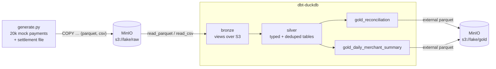

# 01 · Data Platform — MinIO + DuckDB + dbt

A small lakehouse on your laptop. Mock payments and a provider settlement file land in MinIO (S3), dbt-duckdb models them through bronze → silver → gold, and the gold layer (including a payment-vs-settlement reconciliation) is written back to MinIO as Parquet.



## Run

```bash
docker compose up --build
```

The `pipeline` container generates data, runs `dbt build` (models + 8 tests) and prints the reconciliation result read back from MinIO:

```
│ matched            │    17502 │ 44538100.07 │ 44538100.07 │
│ missing_settlement │      374 │   957448.21 │        NULL │
│ amount_mismatch    │      183 │   475463.06 │   475280.06 │
│ orphan_settlement  │       15 │        NULL │     3750.00 │
```

Browse the lake in the MinIO console at http://localhost:9001 (`minioadmin` / `minioadmin`). Stop with `docker compose down -v`.

## What it shows

| Tool | Abilities used |
|---|---|
| MinIO | S3-compatible object store, raw and gold zones, Hive-partitioned Parquet (`status=paid/…`) |
| DuckDB | `httpfs` S3 secret, SQL data generation, `COPY … PARTITION_BY`, querying Parquet/CSV straight from S3 |
| dbt | sources with external locations, `ref` lineage, view / table / external materialisations per layer, generic tests |

The reconciliation model mirrors a real settlement recon: a full outer join between paid payments and the provider file, classified into `matched`, `amount_mismatch`, `missing_settlement` and `orphan_settlement`.
