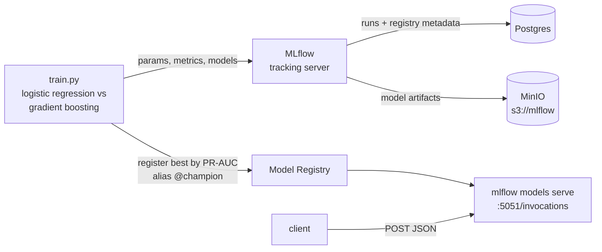

# 02 · MLOps — MLflow

Train two fraud-detection models on synthetic payments, track every run in MLflow, register the better one as `fraud-detector@champion`, and serve it as a REST endpoint.



## Run

```bash
docker compose up --build
```

`train` logs two runs and promotes the winner; `serve` then loads `models:/fraud-detector@champion`. Score two transactions:

```bash
curl -s -X POST localhost:5051/invocations -H 'Content-Type: application/json' -d '{
  "dataframe_records": [
    {"amount": 250,   "hour": 14, "txn_count_24h": 1,  "is_new_device": 0, "merchant_risk": 0.1},
    {"amount": 48000, "hour": 3,  "txn_count_24h": 12, "is_new_device": 1, "merchant_risk": 0.9}
  ]}'
# {"predictions": [0, 1]}
```

- MLflow UI: http://localhost:5050 (compare runs, see the registered model and its alias)
- MinIO console: http://localhost:9101 (`minioadmin` / `minioadmin`)

Stop with `docker compose down -v`.

## What it shows

| Tool | Abilities used |
|---|---|
| MLflow Tracking | experiments, runs, params, metrics, model logging with signature + input example |
| MLflow Registry | model versions, `@champion` alias for promotion without redeploying code |
| MLflow Serving | `mlflow models serve` exposing the registered model over REST |
| Postgres + MinIO | production-style backend store and artifact store instead of local files |
