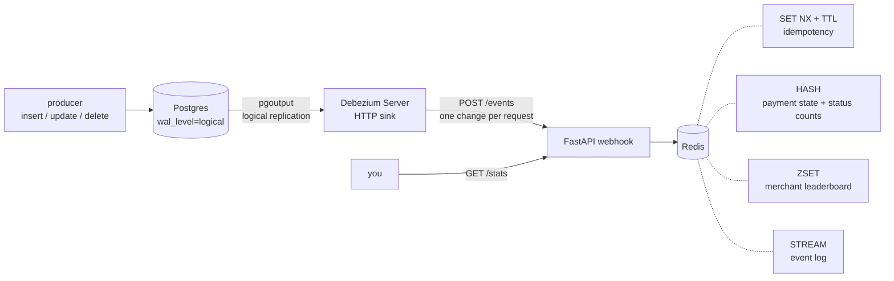

# 03 · Realtime Ingestion — Postgres + Debezium Server + Redis

Change data capture without Kafka. A producer keeps inserting, updating and deleting payments in Postgres; standalone Debezium Server reads the WAL and POSTs each change to a webhook, which keeps live aggregates in Redis.



## Run

```bash
docker compose up --build
```

Debezium snapshots the 20 seed rows (`op=r`), then streams live changes. Watch the aggregates update:

```bash
curl -s localhost:8300/stats
```

```json
{"events_by_op": {"r": "21", "c": "49", "u": "17", "d": "2"},
 "payments_by_status": {"paid": 33, "pending": 33, "failed": 2},
 "top_merchants_by_paid_amount": {"m_0006": 17547.77, "m_0003": 13008.52},
 "last_event_lag_ms": "531",
 "event_log_length": 89}
```

Make your own change and see it arrive:

```bash
docker compose exec postgres psql -U postgres -d shop -c "UPDATE payments SET status='paid' WHERE status='pending'"
docker compose exec redis redis-cli XREVRANGE stream:payment_events + - COUNT 1
```

Stop with `docker compose down -v`.

## What it shows

| Tool | Abilities used |
|---|---|
| Postgres | logical replication (`wal_level=logical`, `pgoutput`), `REPLICA IDENTITY FULL` for full before-images on delete |
| Debezium Server | standalone (no Kafka), initial snapshot + streaming, HTTP sink, `ExtractNewRecordState` SMT, delete rewrite, file offsets |
| Redis | `SET NX EX` idempotency for at-least-once delivery, hashes, sorted sets, streams, pipelined writes |
| FastAPI | webhook receiver + stats API |
