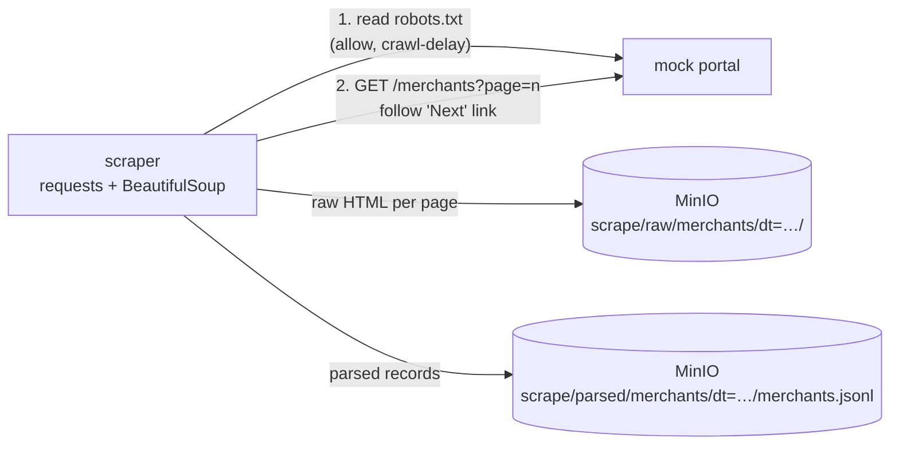

# 04 · Web Scraping → MinIO

A polite crawler for a paginated merchant directory. It respects `robots.txt` and its crawl delay, retries transient errors, keeps the raw HTML for replay, and writes parsed records as JSONL — both partitioned by run date in MinIO.

The target is a local mock portal (`../shared/mock-portal`), so the project runs offline and never breaks because a real site changed.



## Run

```bash
docker compose up --build
```

```
page 1: 20 merchants
…
page 5: 15 merchants
landed 5 raw pages and 95 parsed merchants in s3://scrape (dt=2026-10-19)
```

- MinIO console: http://localhost:9401 (`minioadmin` / `minioadmin`)
- The portal itself: http://localhost:8400

Stop with `docker compose down -v`.

## What it shows

| Ability | How |
|---|---|
| Crawl etiquette | `robots.txt` allow/disallow + `Crawl-delay`, custom User-Agent |
| Resilience | `requests` session with retry + backoff on 429/5xx |
| Pagination | follows the `Next` link until it disappears |
| Parsing | CSS selectors with BeautifulSoup |
| Landing zones | raw HTML (replayable) and parsed JSONL, Hive-style `dt=` partitions, source URL kept as object metadata |
