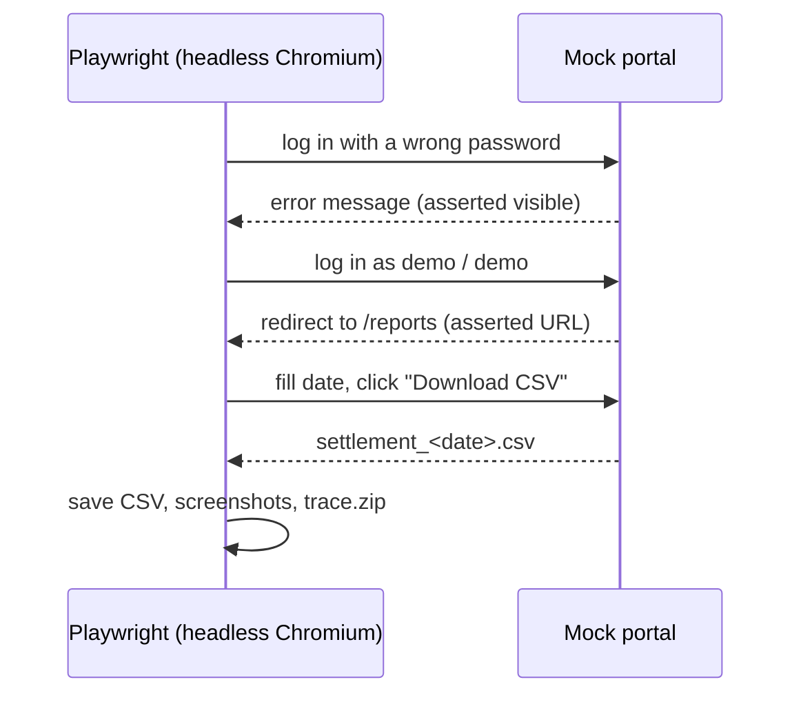

# 05 · Browser Automation — Playwright

Automates the kind of portal that has no API: log in, pick a date, download the settlement report. It asserts each step, and keeps screenshots plus a full Playwright trace as evidence.

The target is a local mock portal (`../shared/mock-portal`) so the run is repeatable.



## Run

```bash
docker compose up --build
```

```
1. wrong password is rejected
2. log in
3. download settlement report for 2026-10-18
4. saved settlement_2026-10-18.csv: 25 merchants, net 6,292,132.17
   evidence in ./output: 01-login-error.png, 02-reports.png, settlement_2026-10-18.csv, trace.zip
```

Open the step-by-step trace (DOM snapshots, screenshots, network) with:

```bash
npx playwright show-trace output/trace.zip
```

Stop with `docker compose down`.

## What it shows

| Ability | How |
|---|---|
| Form automation | `fill` / `click` on a login form |
| Assertions | `expect(...).to_be_visible()`, `expect(page).to_have_url(...)` auto-waiting |
| Downloads | `page.expect_download()` + `save_as` using the server's filename |
| Evidence | screenshots per step and `context.tracing` → `trace.zip` |
| Headless in Docker | official Playwright image, no local browser install |
