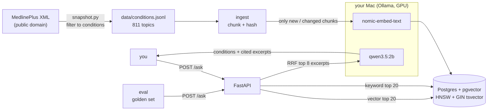

# 06 · RAG — Postgres + pgvector + Ollama

> **Not medical advice.** A portfolio demo that searches MedlinePlus summaries. See a doctor for any health concern.

Describe your symptoms and get back possible conditions, each one cited to a MedlinePlus page. An ingest worker chunks and embeds 811 MedlinePlus condition topics into pgvector. The API runs hybrid search (vector + Postgres full-text, merged with reciprocal rank fusion), then a small local LLM names the matching conditions using only the retrieved excerpts. An eval job scores retrieval and grounding against a golden set.



## Run

The models run in [Ollama](https://ollama.com) on the host, not in Docker, so they can use the Mac's GPU. Inside Colima or Docker Desktop they would be CPU-only and too slow to demo.

```bash
brew install ollama && ollama serve          # or the Ollama app
ollama pull nomic-embed-text && ollama pull qwen3.5:2b
docker compose up --build
```

`ingest` embeds 1,930 chunks (about a minute), then exits. A second run skips all of them:

```
chunks: 1930 total, 0 embedded, 1930 unchanged, 0 deleted
```

Ask a question:

```bash
curl -s localhost:8600/ask -H 'content-type: application/json' \
  -d '{"symptoms": "sudden intense pain in the big toe joint, red and swollen"}'
```

```json
{"disclaimer": "Not medical advice. ...",
 "attribution": "Source: MedlinePlus, National Library of Medicine",
 "conditions": [
   {"name": "Gout",
    "why": "Symptoms include intense pain in the big toe joint, redness, and swelling, ...",
    "sources": [{"n": 1, "title": "Toe Injuries and Disorders", "url": "https://medlineplus.gov/toeinjuriesanddisorders.html"},
                {"n": 3, "title": "Gout", "url": "https://medlineplus.gov/gout.html"}]},
   {"name": "Arthritis", "why": "...", "sources": [{"n": 6, "title": "Arthritis", "url": "..."}]}],
 "retrieved": [
   {"n": 1, "title": "Toe Injuries and Disorders", "score": 0.0323, "vector_rank": 1, "keyword_rank": 3},
   {"n": 2, "title": "Joint Disorders", "score": 0.032, "vector_rank": 3, "keyword_rank": 2},
   {"n": 3, "title": "Gout", "score": 0.0311, "vector_rank": 2, "keyword_rank": 7}],
 "generation": {"done_reason": "stop", "tokens": 132},
 "timings_ms": {"retrieve": 31, "generate": 2647}}
```

Run the eval:

```bash
docker compose run --rm eval
```

```
case                                                           retr  ans  grnd   stop  answer
high fever, severe headache, pain behind the eyes, joint and     NO   NO 1/2     stop  Chikungunya, Dengue
always thirsty, urinating a lot, losing weight without tryin     NO   NO 3/3     stop  Diabetes Insipidus, Macular Degeneration, Overactive Bladder
thick red patches of skin covered with silvery scales that i    yes  yes 1/1     stop  Psoriasis
wheezing, coughing at night, chest tightness, shortness of b     NO   NO 5/5     stop  Acute Bronchitis, Chronic Bronchitis, Emphysema
burning pain when urinating, strong urge to urinate often, c    yes  yes 4/4     stop  Urinary Tract Infections, Interstitial Cystitis, Overactive Bladder
painful blistering rash on one side of the body, had chicken    yes  yes 5/5     stop  Chickenpox, Shingles, Blisters
sudden intense pain in the big toe joint, red and swollen       yes  yes 2/2     stop  Gout, Arthritis
cough lasting weeks, coughing up blood, night sweats, weight     NO   NO 1/1     stop  Whooping Cough
sudden numbness on one side of the face, slurred speech, tro    yes  yes 3/3     stop  Transient Ischemic Attack, Ischemic Stroke, Hemorrhagic Stroke
pain starting near the belly button that moves to the lower     yes  yes 1/1     stop  Appendicitis

retrieval hit 6/10 · answer hit 6/10 · grounded 26/27 named conditions
```

- **retr**: an expected topic is in the 8 retrieved excerpts.
- **ans**: an expected topic is among the conditions the model named *and* grounded.
- **grnd**: named conditions whose name is exactly the title of an excerpt they cite. In the first row the model added "Dengue" from its own knowledge; Dengue was not retrieved, so it does not count.

Retrieval is the bottleneck: in this run, every time the right topic was retrieved the model named it. Without structured output (Ollama does not offer it for qwen3.5 yet), the 2B model occasionally writes invalid JSON and that case scores zero. Misses come from broader topics outranking the specific one (for example "Urine and Urination" above "Diabetes").

Stop with `docker compose down -v`.

## Refresh the data

`data/conditions.jsonl` is a committed snapshot of the 2026-10-21 MedlinePlus file, so runs are repeatable. To refresh it:

```bash
docker compose run --rm ingest python snapshot.py
docker compose run --rm ingest        # embeds only what changed
```

`snapshot.py` keeps English topics, drops anything in the `Symptoms` group, and drops topics whose groups are all non-conditions (tests, wellness, nutrition and so on, listed in `config.yaml`). A few non-diseases still get through, such as "Vaccines" and "Kidney Tests", because they also sit in a body-system group.

## What it shows

| Tool | Abilities used |
|---|---|
| Postgres + pgvector | `vector(768)` with an HNSW cosine index, generated `tsvector` column with a GIN index, hybrid search with reciprocal rank fusion in one SQL query |
| Ingest | XML → plain text, paragraph-packed chunks that each carry their title, content hashes so re-runs only embed what changed and delete what left |
| Ollama | `nomic-embed-text` with its `search_document:` / `search_query:` prefixes, `qwen3.5:2b` with thinking off and a token cap |
| FastAPI | `/ask` returns answer, citations, retrieved ranks, stop reason and timings; a reply that is not valid JSON is returned as `generation.unparsed` rather than dropped |
| Eval | golden set scored on retrieval hit, grounded answer hit and grounding rate |

## Data and licence

Source: MedlinePlus, National Library of Medicine. MedlinePlus health topic summaries are US government works in the public domain ([terms](https://medlineplus.gov/about/using/usingcontent/)). Only those summaries are used; the copyrighted A.D.A.M. encyclopedia content and drug monographs are not.
