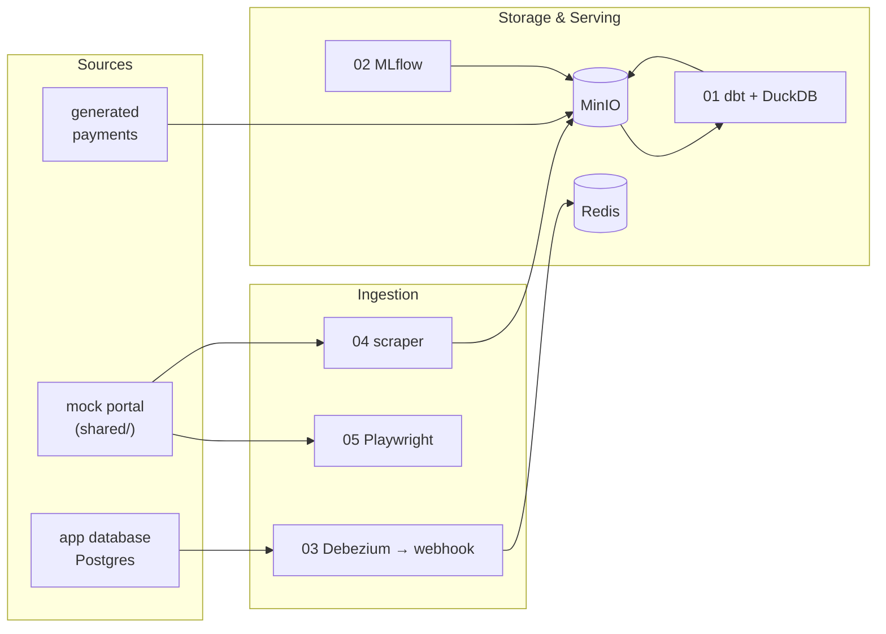

# Suhendro Winton — Data & AI Platform Portfolio

Six small, runnable projects. Each one shows the core abilities of a platform I use day to day. Each runs on its own with `docker compose up --build` (06 also needs [Ollama](https://ollama.com) on the host), needs no cloud account, and has a diagram and expected output in its README.

**Site:** https://swinton7.github.io/portfolio · **LinkedIn:** [suhendro-w-1907a4112](https://www.linkedin.com/in/suhendro-w-1907a4112) · **Email:** suhendro.winton@gmail.com

| # | Project | Stack | What it demonstrates |
|---|---|---|---|
| 01 | [Data Platform](01-data-platform) | MinIO · DuckDB · dbt | S3 lakehouse, medallion layers, tested models, payment-vs-settlement reconciliation |
| 02 | [MLOps](02-mlops) | MLflow · Postgres · MinIO · scikit-learn | experiment tracking, model registry with `@champion` alias, REST model serving |
| 03 | [Realtime Ingestion](03-realtime-ingestion) | Postgres · Debezium Server · Redis · FastAPI | Kafka-less CDC over an HTTP webhook, idempotent realtime aggregates |
| 04 | [Web Scraping](04-web-scraping) | requests · BeautifulSoup · MinIO | polite paginated crawling, raw + parsed landing zones |
| 05 | [Browser Automation](05-browser-automation) | Playwright | login, assertions, file download, screenshots + trace evidence |
| 06 | [RAG](06-rag) | Postgres · pgvector · Ollama · FastAPI | symptom → possible conditions over MedlinePlus, hybrid search with RRF, cited answers, retrieval + grounding eval |

## Requirements

Docker with Compose v2 (Docker Desktop, Colima or OrbStack). Projects use different host ports, so they can run side by side.

MinIO's official images are no longer published, so the projects use [`pgsty/minio`](https://hub.docker.com/r/pgsty/minio), a community build of the same open-source server.
